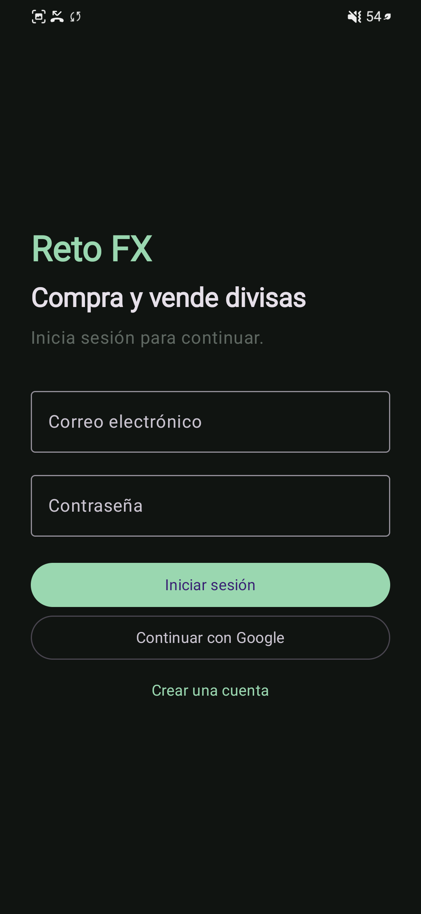
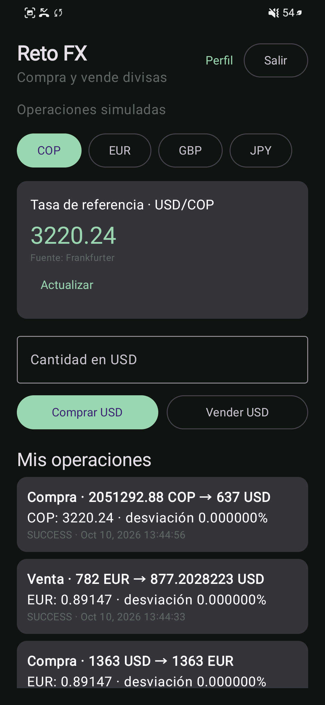
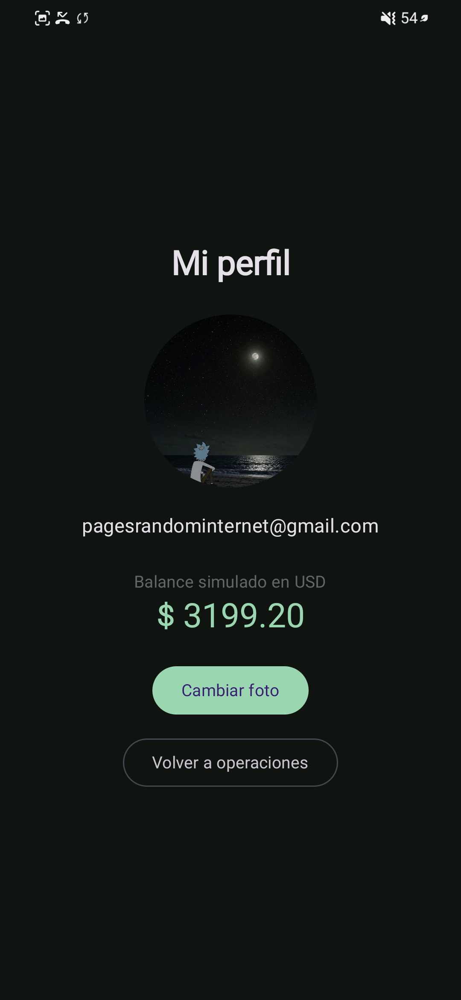
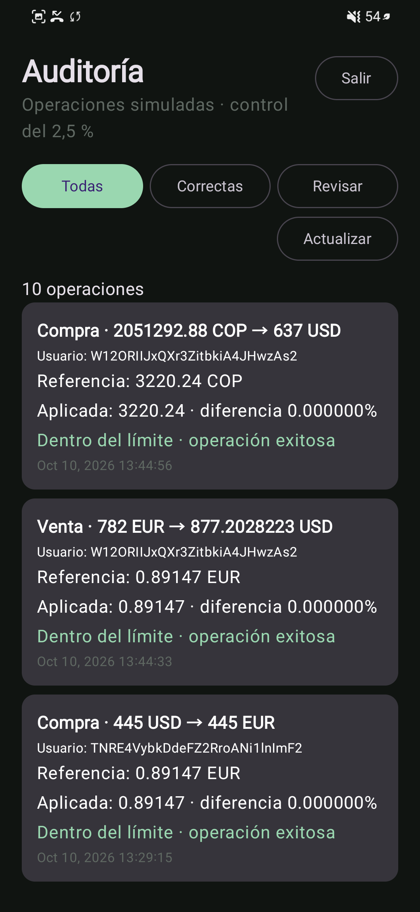

# Reto FX

Aplicación Android para simular la compra y venta de divisas, con cuentas de usuario y un panel de auditoría para administradores.

## Acceso de demostración al panel de auditoría

- **Correo:** `admin@gmail.com`
- **Contraseña de demostración:** `admin123`

Inicia sesión desde la pantalla inicial. La app reconoce el rol administrador mediante un documento cuyo ID coincide con el UID de Firebase Authentication en la colección `admin` o `admins` de Cloud Firestore. Estas credenciales son solo para la demostración académica; cámbialas y no las reutilices si la cuenta contiene datos reales.

## Capturas de la app

| Inicio de sesión | Operaciones de divisas | Perfil |
| :---: | :---: | :---: |
|  |  |  |

| Panel de auditoría |  |  |
| :---: | :---: | :---: |
|  |  |  |

> Las capturas son imágenes de una sesión de demostración. La lista de operaciones puede mostrar registros creados con versiones anteriores de la lógica; las nuevas operaciones registran explícitamente lo que se entrega y lo que se recibe.

## Funciones

### Autenticación y roles

- Registro con correo y contraseña, incluidos dos campos para confirmar que coincidan.
- Inicio de sesión con correo/contraseña o Google mediante Firebase Authentication.
- El usuario normal accede al módulo de cambio y a su perfil.
- El administrador accede al panel de auditoría. Su documento en Firestore debe usar como ID el UID de la cuenta de Firebase Authentication e incluir el campo `role: "admin"` (la app determina el rol por la existencia del documento).

### Compra y venta simulada

- Consulta referencias para COP, EUR, GBP y JPY frente al USD.
- Intenta obtener la tasa desde Finnhub y usa Frankfurter como respaldo cuando Finnhub falla o no ofrece esa cotización.
- Para COP, la operación compra o vende USD: comprar USD muestra el pago en COP y el resultado en USD.
- Para EUR, GBP y JPY, la operación compra o vende la moneda seleccionada: al comprar se paga en USD; al vender se entrega la moneda elegida y se recibe USD.
- Muestra el importe y las monedas que se entregan y reciben antes de registrar la operación.
- Guarda operaciones exitosas y rechazadas en Firestore. El balance simulado en USD se calcula a partir del historial.

### Auditoría

- El administrador puede consultar las operaciones de todos los usuarios y filtrarlas como **Todas**, **Correctas** o **Revisar**.
- Cada registro muestra usuario, importes y monedas, tasa de referencia, tasa aplicada, desviación, estado y fecha.
- La operación debe respetar el límite de desviación del **2,5 %** respecto a la tasa de referencia. Las reglas de Firestore también validan este límite al crear operaciones.

### Perfil y fotografía

- El usuario puede ver su correo y balance simulado en USD, y agregar o cambiar su foto de perfil.
- La imagen se sube a Cloudinary; su URL se guarda en Firestore junto al perfil.
- Las cargas aceptan imágenes de hasta 5 MB y usan un preset unsigned.

## Tecnologías y arquitectura

- Kotlin y Jetpack Compose con Material Design 3.
- Arquitectura MVVM: pantallas Compose, `ViewModel`, modelos y repositorios.
- Firebase Authentication para cuentas, Google Sign-In y Firebase Cloud Firestore para perfiles y operaciones.
- Finnhub y Frankfurter para tasas de referencia; Cloudinary para fotos de perfil.

## Configuración local

1. Abre el proyecto en Android Studio con soporte para Kotlin y Jetpack Compose.
2. Registra una aplicación Android con el ID `com.example.reto2` en Firebase y descarga su `google-services.json` dentro de `app/`. Ese archivo está excluido de Git.
3. Habilita los proveedores **Correo electrónico/contraseña** y **Google** en Firebase Authentication, y crea la base de datos Cloud Firestore.
4. Copia `.env.example` a `.env` en la raíz y completa la clave Finnhub, el nombre del cloud de Cloudinary y el preset unsigned:

   ```dotenv
   FINNHUB_API_KEY=tu_clave_finnhub
   CLOUDINARY_CLOUD_NAME=tu_cloud_name
   CLOUDINARY_API_KEY=not_required_for_unsigned_uploads
   CLOUDINARY_UPLOAD_PRESET=tu_preset_unsigned
   ```

   `.env` está excluido de Git. En este flujo unsigned, la app utiliza el nombre del cloud y el preset; no necesita enviar la API secret de Cloudinary.

5. Publica las reglas desde la raíz del proyecto, después de autenticar Firebase CLI:

   ```bash
   firebase deploy --only firestore:rules --project reton2-87867
   ```

6. Para crear o revisar el rol admin, busca el UID de `admin@gmail.com` en Firebase Authentication y crea en Firestore `admin/{UID}` (o `admins/{UID}`) con un campo de texto `role` igual a `admin`. Cierra e inicia sesión en la app para que se vuelva a cargar el rol.

Para usar Google Sign-In en otra máquina o firma, registra también la huella SHA-1 correspondiente en la configuración de la app Android de Firebase.

## Datos persistidos

- `users/{UID}`: correo, fecha de creación y URL de foto de perfil.
- `transactions/{ID}`: usuario, operación, cantidades entregadas/recibidas, tasa, desviación, estado y fecha.
- `admin/{UID}` o `admins/{UID}`: asignación del rol administrador.

Las reglas impiden que un usuario lea operaciones ajenas o modifique registros después de crearlos. El panel administrador puede leer el historial para auditarlo.
